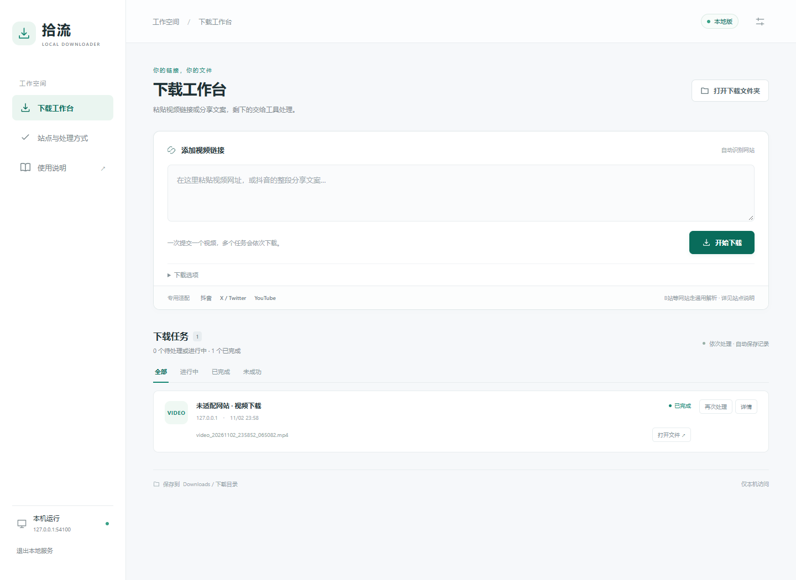
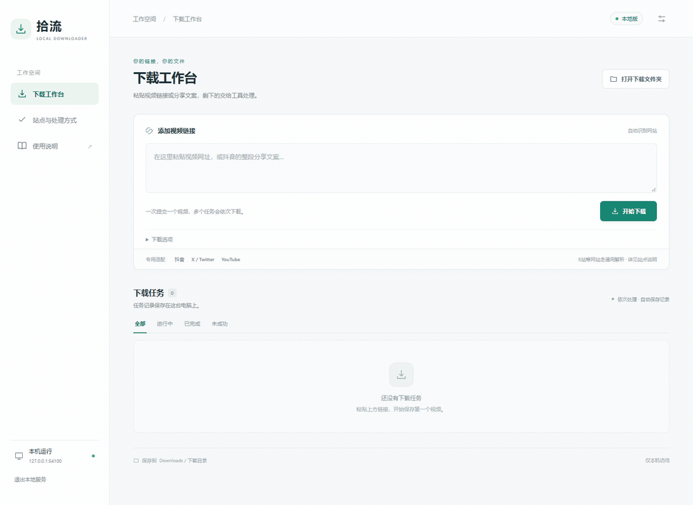

# Shiliu Downloader · 拾流

[简体中文](README.md) · English

**Paste a video link, follow its progress in a local workspace, and save the video on your own Windows PC.**

Shiliu brings site detection, downloading and audio/video merging into one workflow, with a task queue, history, cancellation and retries. You do not have to assemble a different download command for each supported site.



*The screenshot and animation use a generated local test clip. Save paths are hidden; no personal account or real viewing history is shown. The interface is currently in Chinese.*

[Download v0.1.0 source release](https://github.com/chenyywww/shiliu-downloader/releases/tag/v0.1.0) · [Installation and usage](docs/usage.en.md) · [Support matrix](docs/support-matrix.md)

## Why Shiliu

- **One input** for individual video pages, share links and complete Douyin share text.
- **Local downloads and merging**: files stay on the computer running the app, using that person's accounts.
- **Visible task state**: queue, download progress, history, cancellation and retries in one web workspace.
- **Site adapters plus generic handling**: known sites use dedicated modules; other pages try webpage configuration, yt-dlp and browser discovery.

## Download and install

**v0.1.0 is a source release, not a self-contained portable EXE.** Prepare these prerequisites:

| Dependency | Requirement |
| --- | --- |
| OS / Python | 64-bit Windows and Python 3.13, the currently tested environment |
| FFmpeg / FFprobe | Installed and on PATH; [official download page](https://ffmpeg.org/download.html) |
| Google Chrome | Installed for workflows that require a browser |
| Node.js | Installed and on PATH for some yt-dlp extraction paths |

1. Download the source ZIP from [Releases](https://github.com/chenyywww/shiliu-downloader/releases) and extract it into its own folder.
2. Run `setup_vendor.cmd` to install Python dependencies. The source ZIP does not contain a full dependency directory.
3. Run `start_web.cmd` and open `http://127.0.0.1:8765`.
4. Paste a specific video link and start downloading. Files are saved to the parent of the project folder by default.

Multiple copies can coexist when they use separate folders and ports; see the [local web guide](docs/local-web.en.md). Command-line users can also run `download.cmd`.

## See the workflow



The demo uses generated local media. Real sites may require your own login or verification, or stop working after site changes.

## How sites are handled

| Input | Handling | Validation scope |
| --- | --- | --- |
| Douyin | Dedicated work identification, signature adaptation and personal-session fallback | One anonymous full download verified after a fresh installation |
| YouTube, X / Twitter | Dedicated routes for each site | Successful records from an existing installation; not all retested online for this release |
| Adapted article pages and players | Dedicated routes or HLS handling | Historical local-download samples; resolve-only may have different success rates |
| Bilibili | Generic yt-dlp path, without a dedicated adapter | User-reported success; not retested online for this release |
| Other pages and direct m3u8 | Page configuration, generic extraction, browser discovery or HLS | Local fixtures covered by automated tests; arbitrary sites are not guaranteed |

An implemented adapter, one successful sample and universal support are different claims. See the [support matrix](docs/support-matrix.md) for domains and limitations.

## Accounts and privacy

- Published files contain no publisher account, cookies, task history, logs or downloaded videos.
- Sessions explicitly saved by the user are encrypted for the current Windows user in `.auth`. Tasks and logs live in `.web`. Both are excluded from Git and distribution packages.
- The app does not automatically read your personal Chrome profile. You complete YouTube, Douyin and X sign-in yourself.
- **Local downloading does not mean no third-party requests**: the public X fallback sends the post identifier to `xunlangbot.com`. Other workflows also contact source sites, APIs or CDNs.
- The project does not remove DRM or grant account or content access you do not have.

## Developers: experimental resolve-only mode

`start_resolver.cmd` provides metadata resolution at `http://127.0.0.1:8766`. Export a small JSON plan, then run `download_plan.cmd` on the computer that will download and merge the media.

Resolution failure never automatically turns the server into a video relay. Sources may be bound to an IP, cookies or headers and require local resolution. This remains a **local experiment**, not a ready-to-deploy public multi-user service. See the [resolve-only guide](docs/resolve-only.en.md).

## Documentation and checks

| English | 简体中文 |
| --- | --- |
| [Usage](docs/usage.en.md) | [安装与使用](使用说明.md) |
| [Local web workspace](docs/local-web.en.md) | [本地网页](本地网页说明.md) |
| [Support matrix](docs/support-matrix.md) | [支持矩阵](docs/support-matrix.zh-CN.md) |
| [Distribution](docs/distribution.en.md) | [分发说明](发布说明.md) |
| [Resolve-only experiment](docs/resolve-only.en.md) | [仅解析实验功能](仅解析说明.md) |
| [Public versions](docs/versions.en.md) | [公开版本](版本与分支.md) |
| [Third-party notices](THIRD_PARTY_NOTICES.md) | [第三方许可说明](docs/third-party.zh-CN.md) |

The public source passed **59 automated checks** with freshly installed Python dependencies in a separate directory, plus an anonymous 1080p short-video download and full decode. These checks used existing Chrome, FFmpeg and Node.js installations. They do not certify a fresh Windows installation or every site.

```powershell
python -X utf8 -m unittest discover -s tests -v
```

[Changelog](CHANGELOG.md) · Original code is under the [MIT License](LICENSE). Third-party code and tools retain their own licenses. Download only content you own or are authorized to download, and follow the source platform's rules.
