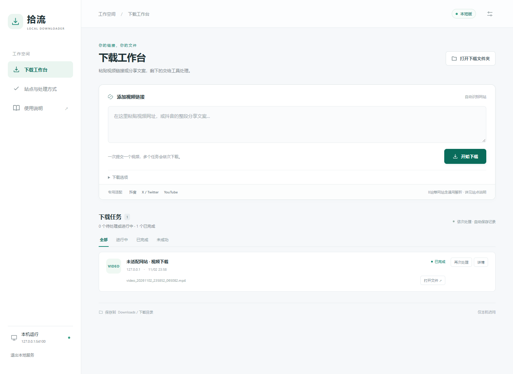
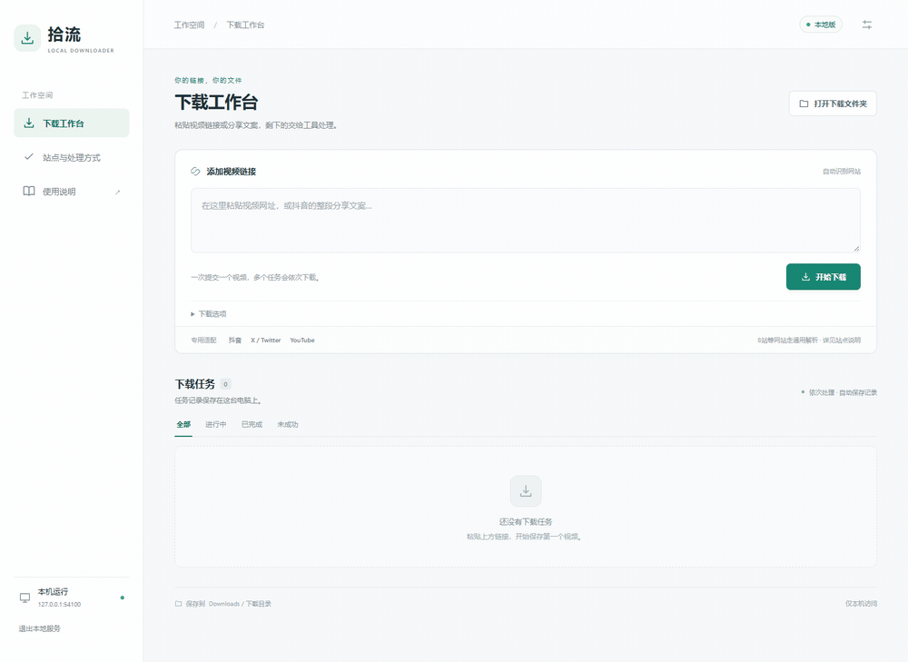

# 拾流 · Shiliu Downloader

简体中文 · [English](README.en.md)

**粘贴作品链接，在本机工作台查看进度，把视频保存到自己的电脑。**

拾流把站点识别、下载和音视频合并放在一个入口里，并提供任务队列、历史记录、取消和失败重试。你不必为每个支持的站点手写不同的下载命令。



*截图和下方动图使用自动生成的本地测试片段；保存路径已隐藏，不包含个人账号或真实作品记录。界面目前为中文。*

[下载 v0.1.0 源码版](https://github.com/chenyywww/shiliu-downloader/releases/tag/v0.1.0) · [安装与使用](使用说明.md) · [站点支持矩阵](docs/support-matrix.zh-CN.md)

## 为什么使用拾流

- **一个输入框**：接受具体作品页、分享短链接，以及抖音整段分享文案。
- **本机下载和合并**：视频保存在运行程序的电脑；每位使用者管理自己的账号与文件。
- **看得见的任务状态**：队列、下载进度、处理记录、取消和失败重试集中在网页里。
- **专用适配加通用处理**：已适配站点使用各自模块，其他站点尝试网页配置、yt-dlp 和浏览器检测。

## 下载与安装

**v0.1.0 是源码版，不是免安装便携 EXE。** 请先准备以下环境：

| 依赖 | 要求 |
| --- | --- |
| 系统 / Python | Windows 64 位、Python 3.13；这是当前验证环境 |
| FFmpeg / FFprobe | 已安装，并加入 PATH；[官方下载入口](https://ffmpeg.org/download.html) |
| Google Chrome | 已安装，供需要浏览器的流程使用 |
| Node.js | 已安装，并加入 PATH，供部分 yt-dlp 流程使用 |

1. 从 [Releases](https://github.com/chenyywww/shiliu-downloader/releases) 下载源码 ZIP 并解压到自己的目录。
2. 双击 `setup_vendor.cmd`，安装 Python 依赖；源码 ZIP 不包含完整依赖目录。
3. 双击 `start_web.cmd`，打开 `http://127.0.0.1:8765`。
4. 粘贴具体作品链接，开始下载。文件默认保存到项目目录的上一级。

同一电脑可以保留多个副本；请使用不同文件夹和端口，见[本地网页说明](本地网页说明.md)。命令行用户也可双击 `download.cmd`。

## 操作演示



演示使用本地生成的测试视频。真实网站可能要求本人登录、验证，或者因站点变化而暂时不可用。

## 哪些站点怎么处理

| 输入 | 处理方式 | 验证说明 |
| --- | --- | --- |
| 抖音 | 专用作品识别、签名适配及本人会话后备 | 独立安装后有匿名完整下载样本 |
| YouTube、X / Twitter | 各自的专用路由 | 有既有安装的成功记录；本次未逐站重新线上验收 |
| 已适配文章及播放器 | 专用路由或 HLS 处理 | 本机流程有历史样本；仅解析不保证相同成功率 |
| B站 / Bilibili | 通用 yt-dlp 流程，无专用模块 | 有用户成功反馈，本次未重新线上验证 |
| 其他网页、直接 m3u8 | 网页配置、通用解析、浏览器检测或 HLS | 自动化测试覆盖本地夹具，不保证任意网站 |

“存在适配模块”“某个样本下载成功”和“所有作品均可用”是不同的含义。完整域名、流程和验证边界见[支持矩阵](docs/support-matrix.zh-CN.md)。

## 账号与隐私

- 发布内容不含发布者的账号、Cookie、任务记录、日志或视频。
- 使用者主动保存的会话位于本机 `.auth`，绑定当前 Windows 用户加密；任务和日志位于 `.web`。两者不进入 Git 或发布包。
- 程序不会自动读取个人 Chrome 资料。YouTube、抖音、X 登录由使用者本人完成。
- **本机下载不等于完全不访问第三方服务**：X 的公开解析后备会把帖子编号发送给 `xunlangbot.com`；其他流程也会请求原站、接口或 CDN。
- 项目不解除 DRM，也不提供原本没有的账号或内容权限。

## 开发者：仅解析实验入口

`start_resolver.cmd` 在 `http://127.0.0.1:8766` 提供元数据解析。它可导出小型 JSON 任务，再由使用者电脑上的 `download_plan.cmd` 下载和合并。

解析失败不会自动变成服务器视频中转。资源可能绑定 IP、Cookie 或请求头，需要在本机重新解析。该功能仍是**本机实验功能**，尚不是可直接部署为互联网多用户服务的成品。详见[仅解析说明](仅解析说明.md)。

## 文档与验证

| 简体中文 | English |
| --- | --- |
| [安装与使用](使用说明.md) | [Usage](docs/usage.en.md) |
| [本地网页](本地网页说明.md) | [Local web workspace](docs/local-web.en.md) |
| [支持矩阵](docs/support-matrix.zh-CN.md) | [Support matrix](docs/support-matrix.md) |
| [分发说明](发布说明.md) | [Distribution](docs/distribution.en.md) |
| [仅解析实验功能](仅解析说明.md) | [Resolve-only experiment](docs/resolve-only.en.md) |
| [公开版本](版本与分支.md) | [Public versions](docs/versions.en.md) |
| [第三方许可说明](docs/third-party.zh-CN.md) | [Third-party notices](THIRD_PARTY_NOTICES.md) |

公开源码曾在独立目录和全新 Python 依赖下完成 **59 项自动检查**，并完成一段匿名 1080p 短视频的下载和解码。测试仍使用已安装的 Chrome、FFmpeg 和 Node.js；这不是全新 Windows 系统或所有站点的兼容性承诺。

```powershell
python -X utf8 -m unittest discover -s tests -v
```

[更新记录](CHANGELOG.md) · 原创代码使用 [MIT License](LICENSE)。第三方源码和外部程序遵循各自许可。仅下载自己拥有或有权下载的内容，并遵守来源平台规则。
